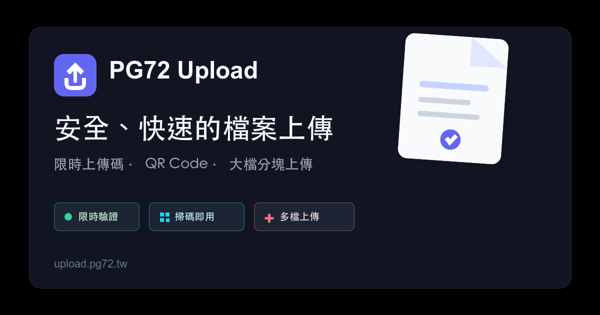
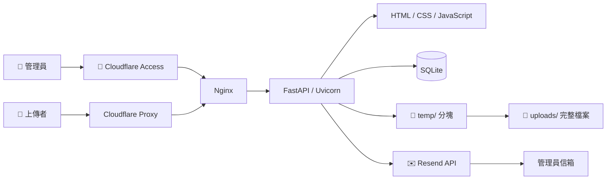
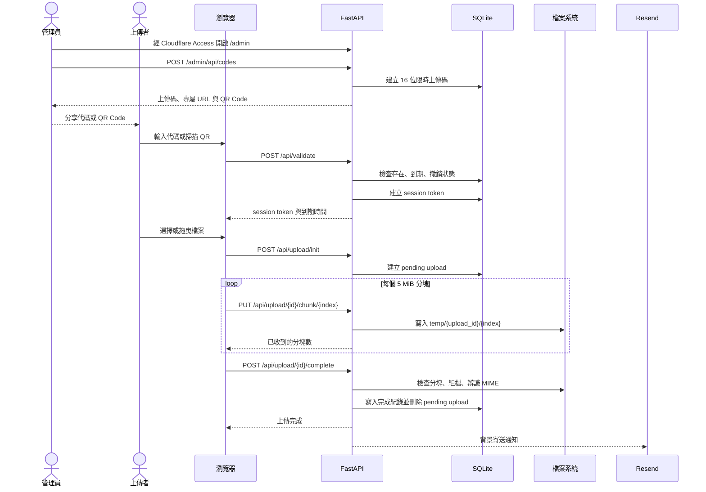

# PG72 Upload

使用限時上傳碼與 QR Code 控制存取的大檔上傳服務。管理員在 Cloudflare Access 保護的後台建立上傳碼，使用者驗證後可以多檔、分塊上傳；完成後系統會寫入 SQLite 紀錄並透過 Resend 通知管理員。



## 功能與圖示

| 圖示 | 功能 | 說明 |
| --- | --- | --- |
| 🔐 | 後台保護 | `/admin` 與其 API 必須通過 Cloudflare Access JWT 驗證 |
| 🔑 | 限時上傳碼 | 管理員建立不含易混淆字元的 16 位代碼，可到期或手動撤銷 |
| 📱 | QR Code | 管理端可顯示、下載 QR，使用者也可用相機掃碼 |
| 🧩 | 分塊上傳 | 瀏覽器以 5 MiB 分塊上傳，後端限制單塊最大 10 MiB |
| 📂 | 多檔與拖曳 | 可一次選取多個檔案，顯示各檔案進度與狀態 |
| 🗃️ | 本機儲存 | 檔案寫入 `uploads/`，索引、代碼與 session 寫入 SQLite |
| ✉️ | 上傳通知 | 組檔完成後以 Resend 寄送檔名、大小、MIME 與儲存名稱 |
| 🧹 | 自動清理 | 每小時清理過期 session，並刪除超過 2 小時的未完成上傳與暫存目錄 |

## 系統架構



Cloudflare 與 Nginx 負責邊界存取與反向代理；FastAPI 同時提供靜態網頁、公開上傳 API 與受保護的管理 API。目前檔案完全儲存在服務器本機，不會透過公開 URL 提供下載。

## 上傳流程



## 使用方式

### 管理員

1. 開啟 `https://upload.pg72.tw/admin`，完成 Cloudflare Access 登入。
2. 按「產生新上傳碼」，取得代碼、專屬 URL 與 QR Code。
3. 複製代碼或下載 QR Code 給上傳者。
4. 在後台檢視代碼狀態、上傳紀錄與容量；必要時可立即撤銷代碼。

### 上傳者

1. 開啟首頁，輸入 16 位上傳碼；也可掃描 QR Code 直接帶入。
2. 驗證通過後，點擊或拖曳一個以上的檔案。
3. 按「上傳所有檔案」，保持頁面開啟直到所有檔案顯示「完成」。

## 快速啟動

### 環境需求

- Python 3.10 以上
- 可用的 Resend API key 與已驗證寄件人（正式通知所需）
- 正式環境需 Cloudflare Access application、Nginx 與 HTTPS 代理
- macOS / Linux 需要系統可讀取的 `libmagic`（macOS 可執行 `brew install libmagic`，Debian / Ubuntu 可執行 `sudo apt-get install libmagic1`）；Windows 由 `python-magic-bin` 提供 DLL

### macOS / Linux

```bash
python3 -m venv .venv
source .venv/bin/activate
python -m pip install -r requirements.txt
cp .env.example .env
# 編輯 .env，本機開發可將 DEV_MODE 設為 true
python main.py
```

### Windows

```bat
copy .env.example .env
rem 編輯 .env，本機開發可將 DEV_MODE 設為 true
start.bat
```

也可在 PowerShell 執行 `./start.ps1`。啟動後開啟：

- 上傳頁：`http://127.0.0.1:3000/`
- 管理頁：`http://127.0.0.1:3000/admin`（僅限 `DEV_MODE=true` 時可跳過 Cloudflare Access）

## 環境變數

將 `.env.example` 複製為 `.env`。`.env` 含敏感資料，不可提交到 Git。

| 變數 | 預設值 | 用途 |
| --- | --- | --- |
| `UPLOAD_DIR` | `./uploads` | 完成檔案的儲存目錄 |
| `TEMP_DIR` | `./temp` | 上傳分塊的暫存目錄 |
| `MAX_FILE_SIZE_BYTES` | `5368709120` | 單檔上限，預設 5 GiB |
| `MAX_CHUNK_SIZE_BYTES` | `10485760` | 後端接受的單塊上限，預設 10 MiB |
| `SESSION_TTL_SECONDS` | `3600` | 新上傳碼的有效秒數 |
| `RESEND_API_KEY` | 必填 | Resend API key |
| `ADMIN_EMAIL` | 必填 | 上傳完成通知收件人 |
| `FROM_EMAIL` | `upload@pg72.tw` | 通知信寄件人，必須通過 Resend 驗證 |
| `CF_TEAM_NAME` | 空 | Cloudflare Zero Trust team name |
| `CF_AUD` | 空 | Cloudflare Access application AUD tag |
| `DEV_MODE` | `false` | `true` 時跳過管理端驗證，僅限本機開發 |
| `BASE_URL` | `https://upload.pg72.tw` | 產生 QR Code 與專屬上傳 URL 的基礎網址 |
| `PORT` | `3000` | Uvicorn 監聽連接埠 |

SQLite 固定建立於專案根目錄的 `upload_service.db`。

## 正式部署

1. 在 Cloudflare Zero Trust 建立保護 `upload.pg72.tw/admin*` 的 Access application，將 team name 與 AUD tag 寫入 `.env`。
2. 確認正式 `.env` 的 `DEV_MODE=false`，並配置 Resend 與正確的 `BASE_URL`。
3. 使用 Uvicorn 或作業系統的 service manager 在 `127.0.0.1:3000` 執行 `main:app`。
4. 參考 [nginx.conf](nginx.conf) 建立反向代理。必須保留 `proxy_request_buffering off`、超時設定與 `Cf-Access-Jwt-Assertion` header 透傳。
5. 將 `uploads/` 與 `upload_service.db*` 納入備份，並限制只有服務帳號可讀寫。

> 重要：`DEV_MODE=true` 會完全跳過管理端 Cloudflare Access JWT 驗證，不可用於公開或正式環境。

## API 摘要

| 方法 | 路徑 | 驗證 | 用途 |
| --- | --- | --- | --- |
| `POST` | `/api/validate` | 上傳碼 | 驗證上傳碼並建立 session token |
| `POST` | `/api/upload/init` | `X-Session-Token` | 建立 pending upload |
| `PUT` | `/api/upload/{upload_id}/chunk/{index}` | `X-Session-Token` | 上傳單一分塊 |
| `POST` | `/api/upload/{upload_id}/complete` | `X-Session-Token` | 檢查分塊、組檔並寄送通知 |
| `GET` | `/admin/api/me` | Cloudflare Access JWT | 取得登入信箱 |
| `GET` | `/admin/api/stats` | Cloudflare Access JWT | 取得統計 |
| `GET` / `POST` | `/admin/api/codes` | Cloudflare Access JWT | 列出或建立上傳碼 |
| `GET` | `/admin/api/codes/{code_id}/qr` | Cloudflare Access JWT | 重新產生 QR Code |
| `DELETE` | `/admin/api/codes/{code_id}` | Cloudflare Access JWT | 撤銷上傳碼 |
| `GET` | `/admin/api/uploads` | Cloudflare Access JWT | 列出最新 200 筆上傳紀錄 |

FastAPI 的 Swagger / ReDoc / OpenAPI 路由已關閉，不會暴露於線上。

## 專案結構

```text
.
├── main.py                 # FastAPI 應用、路由掛載、定期清理
├── config.py               # Pydantic 環境變數設定
├── database.py             # SQLite schema 與資料存取
├── routes/
│   ├── upload.py          # 公開驗碼與分塊上傳 API
│   └── admin.py           # Cloudflare Access 驗證與管理 API
├── utils/
│   ├── code_gen.py        # 安全隨機上傳碼
│   ├── file_handler.py    # 檔名建立、組檔、MIME 與暫存清理
│   └── email_helper.py    # Resend 通知信
├── static/
│   ├── index.html         # 上傳頁與 OG metadata
│   ├── admin.html         # 管理頁
│   ├── css/style.css      # 共用樣式與 RWD
│   ├── js/                # 上傳與管理端互動
│   ├── favicon.svg        # 網站圖示
│   ├── og-preview.svg     # OG 圖可編輯原稿
│   └── og-preview.png     # 1200 x 630 社群預覽圖
├── nginx.conf              # 反向代理範例
├── requirements.txt         # Python 依賴
├── start.bat / start.ps1    # Windows 啟動腳本
└── AGENTS.md                # AI coding agent 專案指引
```

## OG 預覽維護

首頁已設定 Open Graph 與 Twitter Card，共用 `static/og-preview.png`。修改預覽圖時，先編輯 `static/og-preview.svg`，再以 ImageMagick 輸出 PNG：

```bash
magick -background none static/og-preview.svg static/og-preview.png
magick identify static/og-preview.png
```

預期尺寸為 `1200x630`。部署後可檢查頁面原始碼的 `og:*` 標籤與 `https://upload.pg72.tw/og-preview.png`是否可公開存取。社群平台可能快取舊圖，更新圖片後需要重新抓取或更換檔名。

## 開發與驗證

專案目前沒有自動化測試。送出修改前至少執行：

```bash
python -m compileall main.py config.py database.py routes utils
```

並在 `DEV_MODE=true` 的本機環境手動檢查：建立上傳碼、驗碼、多檔分塊上傳、進度顯示、上傳紀錄與撤銷代碼。

## 安全注意事項

- 不要提交 `.env`、SQLite 檔案、`uploads/` 或 `temp/`。
- 不要在正式環境開啟 `DEV_MODE`。
- 上傳 API 必須繼續驗證 session 與其對應上傳碼的到期、撤銷狀態。
- 現行 MIME 檢查只會在通知信標記危險類型，不是防毒或惡意程式掃描。
- 若將來加入下載 API，必須額外實作授權、`Content-Disposition` 與路徑穿越防護。
