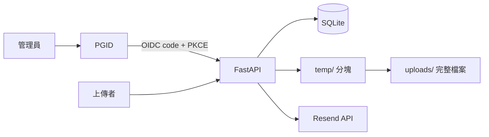

# PG72 Upload

使用限時上傳碼與 QR Code 控制存取的大檔上傳服務。管理員以 PGID OIDC 登入後建立上傳碼，上傳者驗證後可多檔、分塊上傳；完成後系統會寫入 SQLite 並透過 Resend 通知管理員。


## 主要功能

| 功能 | 說明 |
| --- | --- |
| PGID SSO | Authorization Code + PKCE S256，驗證 state、nonce、callback `iss`、ID Token 與 UserInfo |
| 管理授權 | 以 PGID 不可變 `sub` 的本機 allowlist 與 `admin` role 雙重驗證 |
| 限時上傳碼 | 管理員建立不含易混淆字元的 16 位代碼，可到期或手動撤銷 |
| QR Code | 管理端可顯示、下載 QR；上傳者以本機託管的 jsQR 掃碼 |
| 分塊上傳 | 瀏覽器以 5 MiB 分塊上傳，後端限制單塊最大 10 MiB |
| 本機儲存 | 檔案寫入 `uploads/`，索引、上傳碼與 session 寫入 SQLite |
| 通知與清理 | 完成後送出含 HTML 與純文字的 Resend 通知，每小時清理過期資料 |

本專案沒有公開檔案下載 API，管理頁只列出 metadata。

## 架構與登入流程



管理流程：

1. `GET /admin` 在沒有有效本機 session 時轉到 `GET /admin/login`。
2. Upload 將一次性 state、nonce 與 PKCE verifier 寫入 SQLite，瀏覽器只取得 opaque transaction cookie。
3. PGID 授權後回到 `GET /admin/auth/callback`。Authlib 透過 discovery/JWKS 驗證 ID Token，再校對 UserInfo `sub`、已驗證 email 與 namespaced role claim。
4. 只有 `admin_identities` allowlist 內且 role 相符的 `sub` 會取得本機 admin session。瀏覽器 cookie 是隨機 opaque value，SQLite 只儲存 SHA-256 hash。
5. 會變更資料的 admin API 另外要求精確同網站 `Origin` 與 session-bound CSRF token。
6. `POST /admin/logout` 先刪本機 session，再 best-effort 撤銷 access token 並執行 OIDC RP-Initiated Logout。

公開上傳流程保持獨立：`POST /api/validate` 將 16 字上傳碼換成 `X-Session-Token`，之後的 init/chunk/complete 只辨識該 upload session，不會接受或依賴 admin cookie。

## PGID client 設定

在 SSO 端建立 confidential web client，下列值必須精確相符：

| 欄位 | 值 |
| --- | --- |
| Client ID | `pg72-upload` |
| Client type | confidential web client (`public=false`) |
| Redirect URI | `https://upload.pg72.tw/admin/auth/callback` |
| Post-logout redirect URI | `https://upload.pg72.tw/admin/logged-out` |
| Grant types | `authorization_code` |
| Response types | `code` |
| Scopes | `openid profile email` |
| Token endpoint auth | `client_secret_post` |
| Require PKCE | `true` |
| Enable end session | `true` |
| Skip consent | `false` |

Client secret 由 SSO 產生，只放在 Upload 伺服器的 `OIDC_CLIENT_SECRET`，不得放入 Git、前端或 log。`skipConsent=false` 保留 PGID 對新應用的授權確認頁。

## 快速啟動

需要 Python 3.10 以上、Resend API key、PGID client 與 `libmagic`。macOS 可執行 `brew install libmagic`，Debian/Ubuntu 可執行 `sudo apt-get install libmagic1`；Windows 由 `python-magic-bin` 提供 DLL。

```bash
python3 -m venv .venv
source .venv/bin/activate
python -m pip install -r requirements.txt
cp .env.example .env
# 編輯 .env 後啟動
python main.py
```

Windows 可以 `start.bat` 啟動，或在 PowerShell 執行 `./start.ps1`。公開上傳頁可在 `http://127.0.0.1:3000/` 預覽；admin OIDC cookie 固定為 `Secure`，本機端到端測試應使用 HTTPS 反向代理或執行自動化測試，沒有跳過登入的開發模式。

## 瀏覽器資產與安全 headers

瀏覽器執行時不依賴第三方 CDN 或外部字型服務。QR 掃描使用原樣收錄的
`jsQR 1.4.0`，版本、npm integrity、bundle SHA-256 與 Apache-2.0 license
記錄於 [`THIRD_PARTY_NOTICES.md`](THIRD_PARTY_NOTICES.md)。UI 使用系統 sans
與 monospace 字型 stack，不會向 Google Fonts 發出請求。

所有 public、admin、API 與 static response 都套用 HSTS、CSP、
`X-Content-Type-Options`、`X-Frame-Options`、Referrer Policy 與 Permissions
Policy。CSP 只允許同源 script/style/API，並為管理端 QR `data:` 圖片與公開
相機預覽保留所需的 `data:` / `blob:`。`/admin` 與 `/api` response 另外固定
為 `no-store`。本機 HTTP 預覽會收到 HSTS header，但瀏覽器只會在 HTTPS
連線上採用它。

## 環境變數

將 `.env.example` 複製為 `.env`。`.env` 含敏感資料，不可提交到 Git。

| 變數 | 預設值 | 用途 |
| --- | --- | --- |
| `UPLOAD_DIR` | `./uploads` | 完成檔案的儲存目錄 |
| `TEMP_DIR` | `./temp` | 上傳分塊的暫存目錄 |
| `MAX_FILE_SIZE_BYTES` | `5368709120` | 單檔上限，預設 5 GiB |
| `MAX_CHUNK_SIZE_BYTES` | `10485760` | 後端接受的單塊上限，預設 10 MiB |
| `SESSION_TTL_SECONDS` | `3600` | 新上傳碼的有效秒數 |
| `RESEND_API_KEY` | 必填 | Resend API key |
| `ADMIN_EMAIL` | 必填 | 上傳完成通知收件人，與 SSO 登入 email 無關 |
| `FROM_EMAIL` | `upload@pg72.tw` | 通知信寄件人，必須通過 Resend 驗證 |
| `BASE_URL` | `https://upload.pg72.tw` | 精確 HTTPS origin，用於 callback、Origin 與 QR URL |
| `OIDC_ISSUER` | `https://sso.pg72.tw` | PGID 精確 HTTPS issuer origin |
| `OIDC_CLIENT_ID` | 必填 | PGID client ID |
| `OIDC_CLIENT_SECRET` | 必填 | confidential client secret |
| `OIDC_BOOTSTRAP_ADMIN_SUB` | 必填 | 第一位管理員的 immutable PGID `sub`，不是 email |
| `OIDC_ADMIN_REQUIRED_ROLE` | `admin` | 該 allowlist identity 必須同時具有的 role |
| `ADMIN_TOKEN_ENCRYPTION_KEY` | 必填 | 本機儲存 OIDC token 的 Fernet key |
| `ADMIN_SESSION_TTL_SECONDS` | `900` | admin session 最長有效秒數 |
| `ADMIN_OAUTH_TRANSACTION_TTL_SECONDS` | `600` | login/logout transaction 有效秒數 |
| `ADMIN_COOKIE_NAME` | `pg72_upload_admin` | admin opaque session cookie 名稱 |
| `PORT` | `3000` | Uvicorn 監聽連接埠 |

產生 Fernet key：

```bash
python -c "from cryptography.fernet import Fernet; print(Fernet.generate_key().decode())"
```

## SQLite migration 與管理員 allowlist

SQLite 預設位於 `./upload_service.db`。應用啟動時會自動執行 `migrations/*.sql`，並在 `schema_migrations` 記錄已套用版本；`0001_admin_oidc.sql` 新增 admin identity、一次性 OIDC transaction 與 admin session table，不會改寫原有 `codes`、`sessions`、`pending_uploads`、`uploads`。部署前仍應備份 `upload_service.db*`。

首次啟動會以 `OIDC_BOOTSTRAP_ADMIN_SUB` 做 `INSERT OR IGNORE`。後續管理員必須使用 PGID 的 `sub` 新增，不能用 email 當授權鍵。範例：

```sql
INSERT INTO admin_identities
  (subject, required_role, is_active, created_at, updated_at)
VALUES
  ('PG72-ID-SUB', 'admin', 1, unixepoch(), unixepoch());
```

停用管理員時將 `is_active` 改為 `0`，下一個 admin request 會移除該本機 session。變更 bootstrap 環境變數不會覆寫現有 role 或狀態。

## 正式部署

切換到 production PGID 的完整步驟（建 client、設 secret、部署、origin lockdown、煙霧測試、rollback）見 [docs/pgid-cutover-runbook.md](docs/pgid-cutover-runbook.md)。摘要：

1. 先在 PGID 建立上述 client，將 client ID/secret 與 bootstrap admin `sub` 寫入 Upload 的 `.env`。
2. 備份 SQLite 後啟動新版本，確認 `schema_migrations` 有 `0001_admin_oidc.sql`。
3. 使用 service manager 在 `127.0.0.1:3000` 執行 `main:app`。
4. 參考 [nginx.conf](nginx.conf) 建立 HTTPS 反向代理，保留 `proxy_request_buffering off` 與長上傳 timeout。應用不讀取 Cloudflare Access identity header。
5. 端到端測試登入、授權頁、建立/撤銷上傳碼與 logout，再驗證一個小檔的公開分塊上傳。
6. 將 `uploads/` 與 `upload_service.db*` 納入備份，只允許服務帳號讀寫。

## API 摘要

| 方法 | 路徑 | 驗證 | 用途 |
| --- | --- | --- | --- |
| `POST` | `/api/validate` | 16 字上傳碼 | 建立 upload session token |
| `POST` | `/api/upload/init` | `X-Session-Token` | 建立 pending upload |
| `PUT` | `/api/upload/{upload_id}/chunk/{index}` | `X-Session-Token` | 上傳單一分塊 |
| `POST` | `/api/upload/{upload_id}/complete` | `X-Session-Token` | 組檔並寄送通知 |
| `GET` | `/admin/login` | OIDC transaction | 開始 PGID 登入 |
| `GET` | `/admin/auth/callback` | state + PKCE + nonce + OIDC validation | 完成登入 |
| `POST` | `/admin/logout` | admin session + Origin + CSRF | 刪除 session、撤銷 token、開始 RP logout |
| `GET` | `/admin/api/me` | admin session | 取得 email、role 與 CSRF token |
| `GET` | `/admin/api/stats` | admin session | 取得統計 |
| `GET` / `POST` | `/admin/api/codes` | admin session；POST 另要 Origin + CSRF | 列出或建立上傳碼 |
| `GET` | `/admin/api/codes/{code_id}/qr` | admin session | 重新產生 QR Code |
| `DELETE` | `/admin/api/codes/{code_id}` | admin session + Origin + CSRF | 撤銷上傳碼 |
| `GET` | `/admin/api/uploads` | admin session | 列出最新 200 筆 metadata |

FastAPI Swagger / ReDoc / OpenAPI 路由已關閉。

## 專案結構

```text
.
├── main.py
├── config.py
├── database.py
├── migrations/0001_admin_oidc.sql
├── routes/
│   ├── upload.py
│   └── admin.py
├── utils/
│   ├── oidc_client.py
│   ├── code_gen.py
│   ├── file_handler.py
│   └── email_helper.py
├── static/
│   └── vendor/jsqr/      # audited jsQR bundle + Apache-2.0 license
├── tests/test_admin_oidc.py
├── THIRD_PARTY_NOTICES.md
├── nginx.conf
├── requirements.txt
└── AGENTS.md
```

## 開發與驗證

```bash
python -m compileall main.py config.py database.py routes utils tests
python -m unittest discover -s tests -v
```

自動化測試使用暫存 SQLite/upload/temp 路徑，不會觸碰正式 DB 或上傳檔。測試包含 OIDC PKCE/state/nonce URL、callback 一次性、allowlist、secure opaque cookie、Origin/CSRF、logout/revoke/state、migration idempotency 與公開上傳 session 隔離。

## 安全注意事項

- 不要提交 `.env`、SQLite、`uploads/`、`temp/` 或 client secret。
- 不得將 email 當成 admin 授權鍵；只使用 PGID issuer 下的 immutable `sub`。
- Admin cookie 維持 `Secure` / `HttpOnly` / `SameSite=Lax`，不要新增跳過 OIDC 的 bypass。
- 上傳 API 必須繼續驗證 upload session 與對應上傳碼的到期、撤銷狀態。
- MIME 檢查只在通知信標示危險類型，不是防毒或惡意程式掃描。
- 通知信 subject 只使用單行 filename；HTML 內容會 escape 所有動態欄位，
  並一併提供純文字 alternative。
- 不要把第三方 browser runtime 改回 CDN；升級 vendored asset 時必須重新
  核對 package integrity、bundle hash、license 與 regression test。
- 未來加入下載 API 時，必須另外實作授權、`Content-Disposition` 與路徑穿越防護。

## OG 預覽維護

`static/og-preview.svg` 是可編輯原稿，`static/og-preview.png` 必須維持 `1200x630`：

```bash
magick -background none static/og-preview.svg static/og-preview.png
magick identify static/og-preview.png
```
